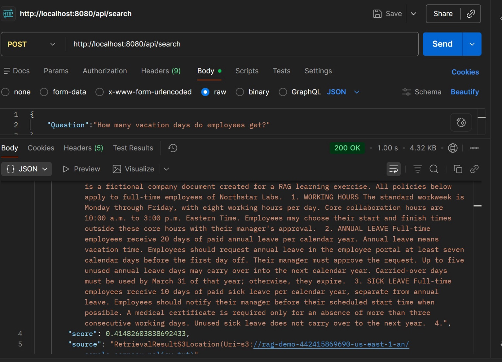
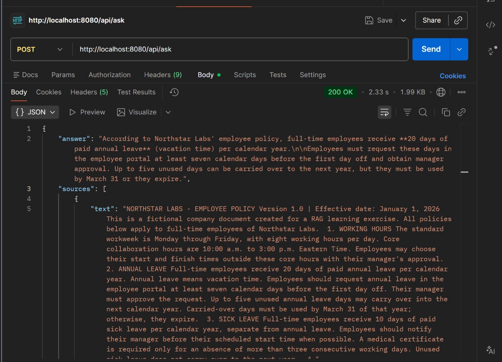
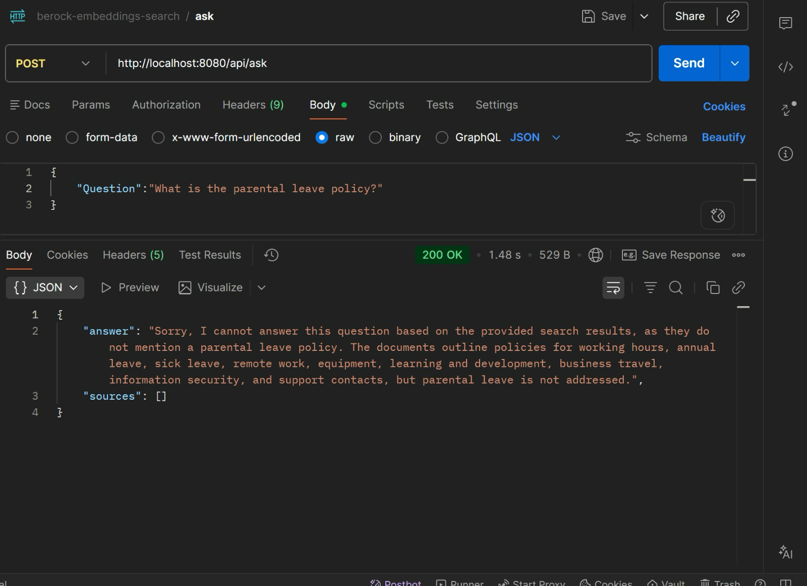

# Bedrock Embedding Search

A personal proof of concept built with Java and Spring Boot to explore retrieval-augmented generation (RAG), text embeddings, document chunking, and vector search using Amazon Bedrock Knowledge Bases.

The application was tested locally with Postman against a single fictional employee-policy document. It provides separate endpoints for inspecting retrieved passages and generating document-grounded answers.

## Technology stack

- Java 17
- Spring Boot and Spring Web
- AWS SDK for Java v2 (`bedrockagentruntime`)
- Amazon Bedrock Knowledge Bases
- Amazon Titan Text Embeddings V2
- Amazon S3 for source documents
- Amazon S3 Vectors for vector storage
- A supported Bedrock text-generation model accessed through an inference profile

## How it works

**Ingestion:** Source document in S3 → Bedrock parsing and chunking → Titan V2 embeddings → vector index.

**Search:** Question → query embedding → similarity search → retrieved chunks, relevance scores, and source locations.

**Question answering:** Question → retrieval → retrieved passages supplied to a language model → generated answer and cited sources.

Bedrock manages document ingestion, embedding generation, and vector storage integration. The Java application calls the Knowledge Base APIs; it does not generate or store embeddings itself. The API responses display chunk text rather than raw numeric embedding arrays.

## API endpoints

| Endpoint | AWS operation | Response |
| --- | --- | --- |
| `POST /api/search` | `Retrieve` | Matching chunks, scores, and source locations |
| `POST /api/ask` | `RetrieveAndGenerate` | Generated answer and supporting sources |

## Prerequisites

1. Java 17+ and Maven, or the project's Maven wrapper.
2. An existing Spring Boot application containing the controller and Bedrock client configuration.
3. An AWS Bedrock Knowledge Base connected to an S3 data source, with a completed successful sync.
4. The Knowledge Base ID and its AWS Region.
5. A supported generation model or inference profile ARN. Use the profile ARN for models that require cross-region inference.
6. AWS credentials with permissions for retrieval, retrieval-and-generation, and the selected model invocation.

This documentation package does not contain the application's Java source or `pom.xml`; add these files to your existing project.

## AWS setup

1. Upload `docs/sample-data/sample-company-policy.txt` to your private S3 bucket.
2. Create a Knowledge Base with an S3 data source, the default text parser, Titan Text Embeddings V2, and S3 Vectors.
3. Configure a supported chunking strategy. Fixed-size chunking is suitable for experimentation.
4. Sync the data source and confirm the ingestion completes without failed documents.
5. Test retrieval in the Bedrock console before calling it from Java.

The original file and its embeddings are stored separately. Updating an S3 document requires another data-source sync before the Knowledge Base reflects the change.

## Maven dependencies

Within a Spring Boot Maven project, include:

```xml
<dependency>
    <groupId>org.springframework.boot</groupId>
    <artifactId>spring-boot-starter-web</artifactId>
</dependency>
<dependency>
    <groupId>software.amazon.awssdk</groupId>
    <artifactId>bedrockagentruntime</artifactId>
    <version>2.55.6</version>
</dependency>
```

The Spring Boot parent or dependency management supplies the Spring dependency version. The SDK version above matches the POC example; it is not a claim about the latest release.

## Application configuration

Use the following properties in `src/main/resources/application.properties`:

```properties
spring.application.name=bedrock-embedding-search
rag.region=${AWS_REGION:us-east-1}
rag.knowledge-base-id=${BEDROCK_KB_ID}
rag.model-arn=${BEDROCK_MODEL_ARN}
```

The client configuration must explicitly pass the custom Region property:

```java
BedrockAgentRuntimeClient.builder()
    .region(Region.of(region))
    .build();
```

Set `BEDROCK_KB_ID` and `BEDROCK_MODEL_ARN` in your IDE run configuration. The configuration property names must exactly match the controller's `@Value` placeholders.

### Local credentials

Use an AWS credentials profile and set `AWS_PROFILE` in the IDE, or provide `AWS_ACCESS_KEY_ID` and `AWS_SECRET_ACCESS_KEY` as environment variables. Temporary credentials also require `AWS_SESSION_TOKEN`.

The AWS SDK uses its default credentials provider chain. An IAM console password is not an SDK credential. Do not commit credentials, local environment files, or root access keys.

## Run locally

Start the Spring Boot main class from your IDE, or run:

```bash
mvn spring-boot:run
```

The examples assume port 8080 and no additional context path.

## Test with Postman

Select **POST**, then **Body → raw → JSON**. Use the URL without a question query parameter, because the controller expects `@RequestBody`.

### Retrieve passages

```bash
curl -X POST http://localhost:8080/api/search \
  -H 'Content-Type: application/json' \
  -d '{"question":"How many vacation days do employees get?"}'
```

Expected: the retrieved text includes 20 days of paid annual leave per calendar year.



Scores indicate retrieval relevance; they are not percentages of confidence or correctness. Returning up to three results can include passages that do not directly answer the question. Setting `numberOfResults(1)` returns only the best matching result; it does not change document chunking.

### Generate a grounded answer

```bash
curl -X POST http://localhost:8080/api/ask \
  -H 'Content-Type: application/json' \
  -d '{"question":"How many vacation days do employees get?"}'
```

Observed: the answer correctly states 20 days and describes the request and carry-over conditions, with a supporting source passage.



The screenshots capture the initial implementation. Its source field uses the AWS object's string representation. To return a clean S3 URI for an S3 source, extract `reference.location().s3Location().uri()` with appropriate null checks.

### Test missing information

```bash
curl -X POST http://localhost:8080/api/ask \
  -H 'Content-Type: application/json' \
  -d '{"question":"What is the parental leave policy?"}'
```

Observed: the model states that the provided results do not specify a parental-leave policy and returns an empty sources list.



An empty citation list does not prove that retrieval returned no chunks. It means no cited references were included in the generated response.

The captured requests use `Question` with a capital Q and succeeded with the local implementation. The commands above use `question` to match the lowercase Java record field in the example controller; retain the field name expected by your implementation.

## Scope and limitations

- Personal learning project tested with one fictional document.
- Demonstrates managed embeddings, semantic retrieval, and RAG integration.
- Manual checks of a few questions; no measured accuracy benchmark or load test.
- Appropriate handling of the unsupported question was observed in the screenshot; this does not guarantee that every unsupported question will be handled correctly.
- Not deployed to production and not an enterprise or regulated-environment implementation.
- Local endpoints need authentication and other operational controls before external deployment.
- No model training or fine-tuning was performed.

## Cost and cleanup

Charges depend on the Region, embedding and generation models, vector store, and usage. Avoid substituting another vector store without checking its billing model. Delete unneeded Knowledge Base, vector index/bucket, and source-document resources after testing.

## Repository notes

Keep this GitLab repository private. The supplied screenshots include AWS resource identifiers; review or redact them before making the repository public. They contain the observed POC results and have not been modified.

## License

All rights reserved. See [LICENSE](LICENSE). This is a private personal project and does not grant an open-source license. Third-party dependencies retain their respective licenses.
